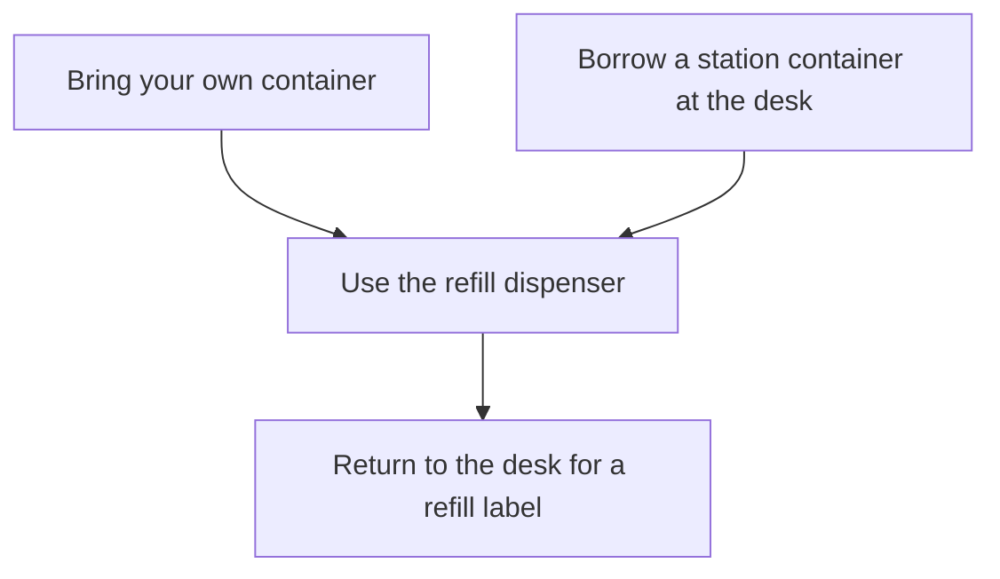

A diagram makes claims that its text never states out loud. An arrow says one thing leads to another, a loop says it happens again, a larger box says it matters more. When you ask an AI tool to turn an approved paragraph into a visual, the words usually survive and the relationships are where things go wrong. The job is to fix the relationships yourself first and let the tool do the drawing.

## Decide the relationship before the layout

Read the paragraph and name the one question the reader needs answered.

| The reader asks | Relationship | Layout that fits | Layouts that add a claim |
| --- | --- | --- | --- |
| What are my options? | Comparison | Equal parallel columns | Funnel, ranking, cycle |
| What happens next? | Sequence | Left-to-right or top-down flow | Cycle, unless the text says it repeats |
| What belongs under this? | Hierarchy | Tree or nested groups | Flow with arrows between siblings |
| How do the parts split? | Proportion | Chart, only with numbers from the text | Any chart drawn from adjectives |

If the paragraph answers more than one of these, make more than one diagram. If you need an overview of a whole document before you can choose a paragraph, start with the [source-grounded mind map workflow](/guides/workflow/source-grounded-ai-mind-map) instead.

## Write the label table

Freeze the paragraph first: its exact text, version and owner. Then list every box and every connector you expect to see. This example is fictional. The approved paragraph for a refill station reads:

> Visitors may bring their own container or borrow a station container at the desk. Either option uses the refill dispenser. After filling, return to the desk for a refill label. The brief does not provide usage shares or say that visitors repeat this activity.

The reader's question is "what are my options?", so this is a comparison with a short shared sequence after it.

| ID | Label | Source sentence | Role |
| --- | --- | --- | --- |
| L1 | Bring your own container | 1 | Option, left |
| L2 | Borrow a station container at the desk | 1 | Option, right |
| L3 | Use the refill dispenser | 2 | Shared step 1 |
| L4 | Return to the desk for a refill label | 3 | Shared step 2 |
| C1 | L1 to L3 | 2 ("either option") | Then |
| C2 | L2 to L3 | 2 ("either option") | Then |
| C3 | L3 to L4 | 3 ("after filling") | Then |

Four boxes, three arrows. Anything else that appears in the draft has no source.

## Generate the draft

**In Napkin.** [Napkin](/tools/napkin-ai) works from text, not from a prompt. Paste or import the paragraph, select it and click the Autospark icon; Napkin proposes several visuals and you pick one. Every element stays editable afterwards. Because it chooses layouts for you, scan the options for the relationship you named and ignore the rest. The free plan gives a weekly allowance of AI credits, charged at roughly one credit per word you select, so select only the paragraph. Napkin imports PPT, DOC, PDF, HTML and Markdown files.

**In Miro.** [Miro](/tools/miro) takes a description. Above the creation toolbar choose **Create with AI**, open the Sidekicks library, then **Formats > Diagram or mindmap**, pick a diagram type and describe what you want. Miro's help center lists this for all plans. Give it the constraints, not only the paragraph:

```text
Create a flowchart from the text below. Two equal option boxes side by side:
"Bring your own container" and "Borrow a station container at the desk".
Both lead to one shared step, "Use the refill dispenser", which leads to
"Return to the desk for a refill label". Exactly four boxes and three arrows.
No loop back to the start, no percentages, no extra steps, no ranking.

[paste the approved paragraph]
```

Miro AI writes the result onto the board as an editable Mermaid-based diagram. A faithful version of this example is short enough to read in full:



That code is hand-written for this guide, not a captured tool output. It is useful as a fallback as well: paste Mermaid code onto a Miro board and Miro renders it as shapes and connectors, so you can skip generation and write the seven lines yourself.

## Check what the draft claims

Compare the draft with the table one row at a time. The typical ways a generated diagram of this paragraph goes wrong:

| What you see | The claim it adds | Fix |
| --- | --- | --- |
| An arrow from L4 back to L1 or L2 | Visitors repeat the process. The word "return" means going back to the desk, not starting over. | Delete the edge. In Mermaid, remove the `L4 --> L1` line. |
| The four boxes arranged in a circle | Same recurrence claim, made by layout alone | Choose a linear or column layout |
| An arrow from L1 to L2 | You must bring a container before borrowing one | Delete it; the options are alternatives |
| One option drawn larger or first with a "recommended" tag | A preference the brief does not state | Equal sizes, neutral order |
| "60%" or a pie icon next to an option | A measured usage share. The brief says there is none. | Remove the figure and the icon |
| "Free container" as a label | A price. Cost is not mentioned. | Restore the approved wording |
| A fifth box such as "Enjoy your drink" | A step nobody approved | Delete it |

Then do one check the table cannot do. Hand the diagram, without the paragraph, to someone who has not read it and ask them to say what it tells them. If their account includes anything the paragraph does not, the diagram is saying it. Fix the diagram; do not edit the approved text to match the picture.

If the draft exposes a real gap, for example nobody knows whether a borrowed container must be handed back, that is a question for the paragraph's owner. Leave the diagram without that step until they answer.

## Export and hand off

Export in the format the destination needs and look at that file, not the canvas. Napkin's free plan exports PNG and PDF and puts Napkin branding on the visual; PowerPoint and SVG export are on its paid plans. In Miro the diagram stays live on the board and its Mermaid source can be copied into a document or repository.

At delivery size, check that both option boxes still visibly connect to the shared steps, that no label is cropped or shrunk past reading, and that the diagram still works in grayscale if it may be printed.

Keep three things with the exported file: the paragraph and its version, the label table, and a one-sentence text equivalent ("Two options, bring or borrow a container, both followed by the dispenser and then a refill label at the desk"). The text equivalent doubles as alt text and lets a later editor see what the visual was meant to say.

If the diagram is going into a deck, the [report-to-presentation workflow](/guides/workflow/ai-presentation-from-report) covers fitting it to the slide's claim. Approval of the diagram covers this paragraph in this version, not the slides around it.
